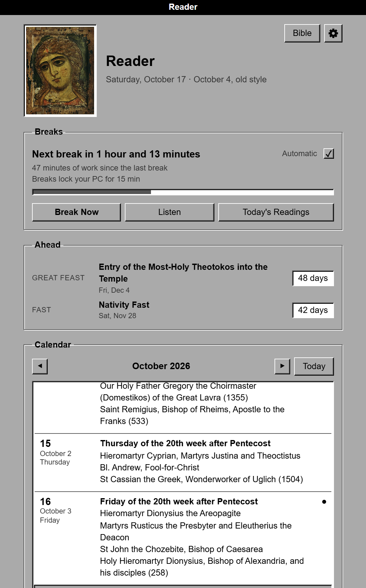
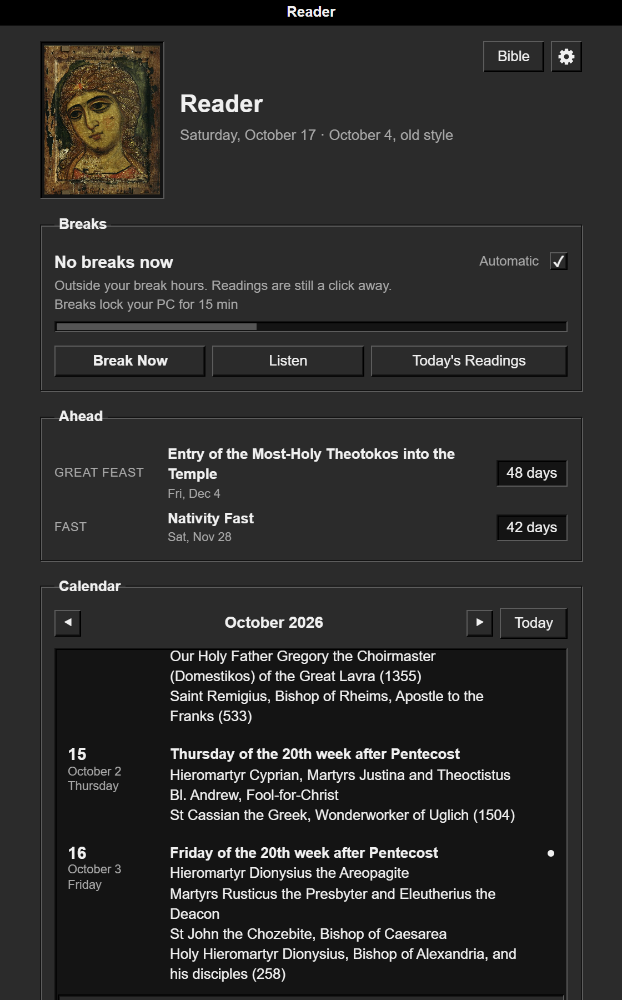
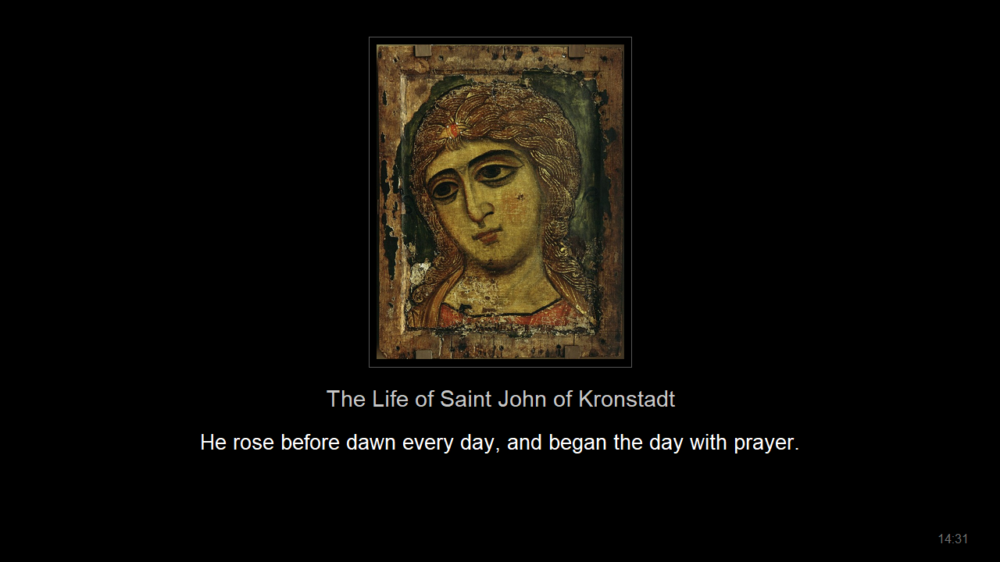
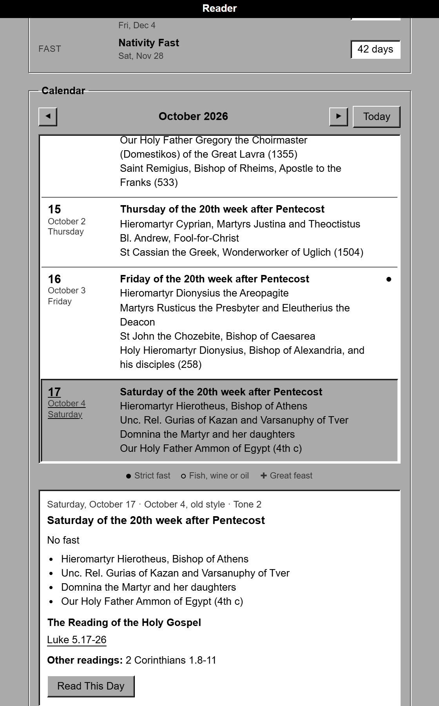
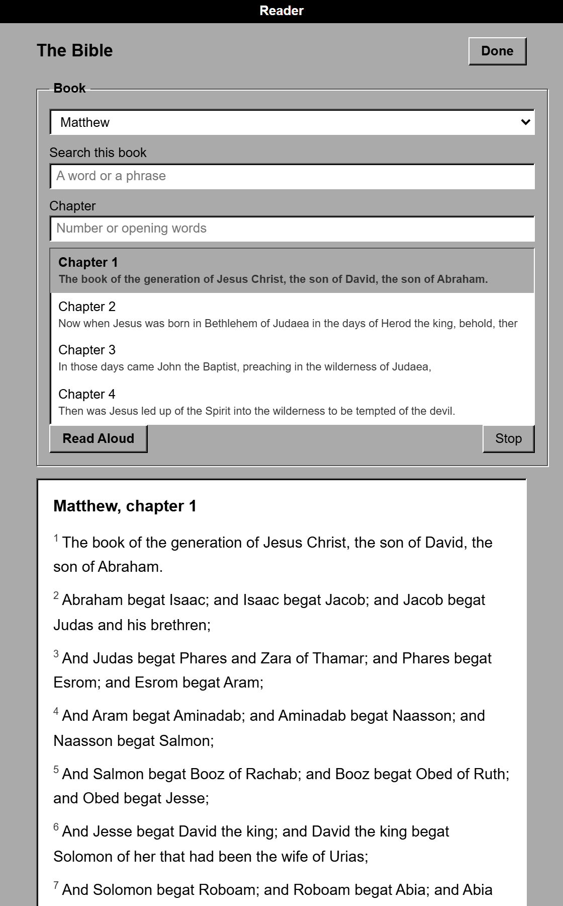
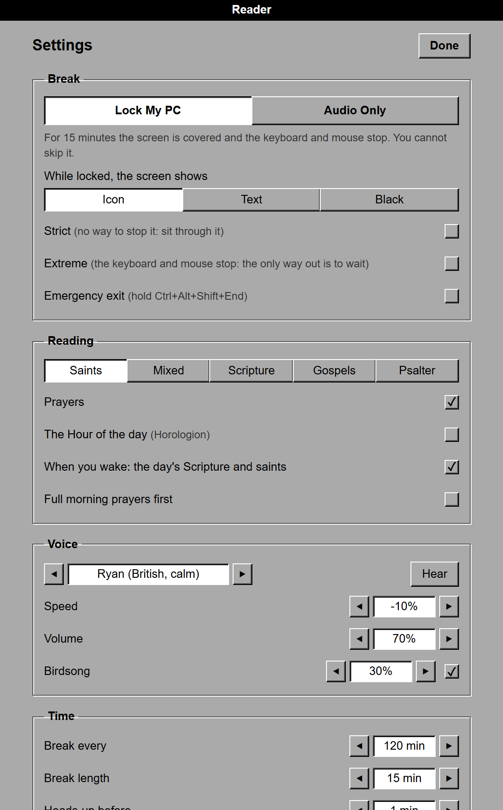
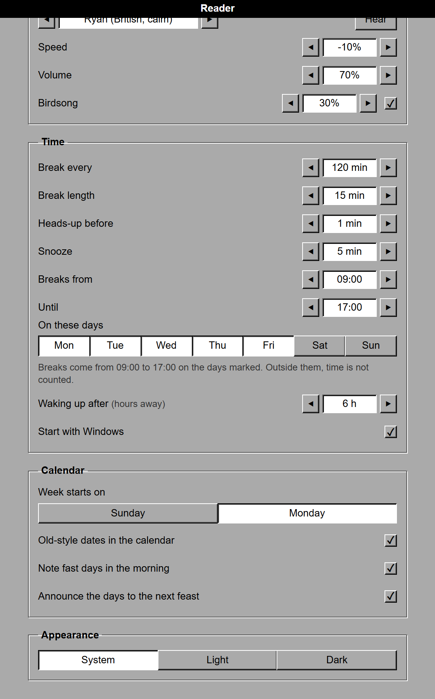

# ☦ Reader

A quiet Orthodox companion for Windows, for people who don't have time to sit down and read. It starts with Windows. When you wake up (six hours or more away from the computer), it reads you the day by the old calendar: the appointed Scripture and the lives of that day's saints, together in one session. Through the day, every two hours of work, it takes a fifteen-minute break and reads lives of the saints over soft birdsong. No streaks, no scores, nothing to keep up with.

<p align="center">
  
  
</p>

<p align="center">
  
  <br><sub>A break in Lock mode: the icon, what is being read, the sentence being spoken, and a quiet clock.</sub>
</p>

- **Read it yourself, or hear it.** The **Bible** button opens the whole Bible in Orthodox order: the Gospels (KJV), Acts and the Epistles, the Psalter (your Septuagint Psalter if you have one), the Old Testament with Tobit, Judith, Wisdom, Sirach and Baruch (Brenton). Read any chapter, or press **Read Aloud**. During a reading, **Show Text** shows the whole text with the sentence being spoken marked, and what comes next.
- **Never the same twice.** Readings are dealt from shuffled decks, not drawn at random: nothing is read again until everything of its kind has been read, and the decks are kept between days. Or choose **Gospels** or **Psalter** to read straight through, continuing where you left off.
- **Two kinds of break.** *Lock screen*: a full-screen icon, the words being read, or darkness, with the mouse and keyboard held for the break. *Audio only*: the reading plays while you keep working, with an optional small window to read along.
- **The day by the old calendar.** The day's feast, fast (strict, or fish/wine/oil allowed) and saints, a month calendar of fasts and feasts with old-style dates, the next great feast and the next fast season, and the appointed Scripture readings, from [orthocal.info](https://orthocal.info). Any day can be read aloud, and a quiet note marks a fast day in the morning.
- **The Hours.** With a Horologion, each break can begin with the Hour of the day: the First, Third, Sixth, Ninth Hour, or Compline.
- **Whole works, never cut off.** Each break is filled with complete pieces of different kinds that fit the time: a chapter of the Wisdom of Solomon or Sirach (Brenton's Septuagint), a psalm, a Gospel or Epistle chapter, a life of a saint, and, from your own books, a life from the Prologue of Ohrid, a thought of St. Theophan, or a homily of St. John Chrysostom.
- **A free voice, in a room.** Microsoft's neural voices through `edge-tts` when online, and the Windows voice offline. No account, no key, no cost. The voice is placed a few metres away in a quiet stone church (distance, early reflections, a soft stereo tail) and kept at a calm level, so it never sits inside your ears.
- **Birdsong and a brook**, synthesised (no recordings), as a seamless loop.
- **Honest about your time.** It measures real use (mouse and keyboard). Fifteen minutes away already counts as a break, and five hours away is a night: a new day.

## Screenshots

| | |
| --- | --- |
|  |  |
| **The day.** Click any day for its feast, fast, saints and readings; open a Gospel or read the whole day aloud. | **The Bible.** Every book in Orthodox order, searchable, with the opening words of each chapter. |
|  |  |
| **The break.** Lock your PC or audio only, what the screen shows, and how hard it is to leave. | **Your schedule.** How often and how long, the heads-up, Snooze, and which hours and days breaks come. |

<p align="center"><br><sub>The heads-up before a break.</sub></p>

## Make the breaks yours

Everything is in **Settings**, and every choice takes effect at once:

| Setting | Choices | Default |
| --- | --- | --- |
| Break | Lock My PC, or Audio Only | Lock |
| While locked, the screen shows | the icon, large text, or black | Icon |
| Break every | 15 min to 8 h | 2 h |
| Break length | 1 to 60 min | 15 min |
| Heads-up before | none to 5 min | 1 min |
| Snooze | off, or 5 to 60 min | 10 min |
| Breaks from / until | any hours; they may cross midnight (22:00 to 02:00) | all day |
| On these days | any of Monday to Sunday | every day |
| Reading | Saints, Mixed, Scripture, Gospels, Psalter | Saints |
| Strict | no Stop and no ✕: sit through it | off |
| Emergency exit | hold Ctrl+Alt+Shift+End for 3 s to end a locked break | off |
| Extreme | the only way out is to wait | off |

Outside your break hours and days, time at the computer is not counted, so a break never lands the moment the window opens. A night that crosses midnight belongs to the day it began on. Extreme ignores the hours and days, so changing the clock or time zone cannot end its breaks.

## Install

Download `Reader.exe` from [Releases](../../releases) and run it. It lives in the tray (the red cross); click it to open the window. Windows SmartScreen may warn about an unsigned app: *More info → Run anyway*.

Or from source (Python 3.11+ on Windows):

```powershell
pip install -r requirements.txt
python main.py            # open the window
python main.py --tray     # start quietly in the tray
powershell -ExecutionPolicy Bypass -File build.ps1   # build dist\Reader.exe
```

## Safety

A locked break can always be ended:

- **Hold Ctrl+Alt+Shift+End for 3 seconds**, if you turn on **Emergency exit** in Settings → Break (off by default, so a break means a break). Strict and Extreme hide it.
- **Ctrl+Alt+Del** always works. Windows never lets a program block it.
- The lock **releases itself** a couple of minutes after the break should have ended, whatever happens, and it dies with the app.
- Breaks can be paused from the window or the tray at any time.

**Extreme mode** (Settings → Break): the only way out of a break is to wait. No Snooze, no Stop, no emergency exit, no Quit, and the break settings are locked while it is on. A second process brings Reader back if it is closed, and a break that was cut off starts over. Extreme can be turned off in Settings between breaks. Ctrl+Alt+Del still works, and each lock still releases itself when the break is over.

## What it reads

Bundled, all public domain:

- Traditional prayers in the older English of Hapgood's *Service Book* (1906) and the King James Version
- The King James Bible (1769)
- Wisdom of Solomon, Sirach, Tobit, Baruch and Judith from Brenton's English Septuagint (1851)

Fetched from orthocal.info and kept on your computer (for offline lives of the saints):

- The day's commemorations, fasting and Scripture readings
- Lives of the saints, gathered slowly into a local library

### Your own books

If you own other translations (a prayer book, a Horologion, a Psalter), `tools/build_my_texts.py` turns them into a private pack in `%APPDATA%\OrthodoxReader\my-texts`. Reader uses that pack in place of the bundled texts. **Nothing from those books is in this repository**, and the pack never leaves your computer.

```powershell
python tools/build_my_texts.py --jordanville "Prayer Book.pdf" --horologion "Horologion.pdf" --psalter liturgy.io
python tools/build_my_texts.py --bot path\to\orthodox-reading-bot   # Prologue, Theophan, Chrysostom
```

The page ranges match the Holy Trinity Monastery *Prayer Book* (4th ed.) and *Unabbreviated Horologion* (2nd ed.). Scanned PDFs are cleaned of OCR errors, and the Hours keep only the parts for the day of the week.

## Design

The look is NeXTSTEP: its four greys (black, dark grey, light grey, white), Helvetica (Arial where it is missing), a black title bar, 1-pixel bevels lit from the top left, etched boxes, button matrices where the chosen button is pressed in and white, and check boxes. The one image is the *Angel with the Golden Hair* (Novgorod, c. 1200), which is also the app icon. Dark mode is the same machine with the lights down; it follows Windows unless you choose one.

Principles, after the way Steve Jobs thought about design:

1. **Focus is saying no.** The main view shows only what you need every day: today, the next break, three actions, the calendar. Everything else is one quiet link away in Settings.
2. **Simplicity is the ultimate sophistication.** The defaults work, and every word has to earn its place.
3. **Design is how it works.** The status says exactly what will happen next, in words; a break is made of whole works, never cut off.
4. **No decoration.** NeXT's greys; the only colour is the angel. No shadows, outlines or gradients; surfaces are told apart by tone and space.
5. **Typography matters.** One face, Helvetica, in a few sizes and weights; the text can be selected like any page.
6. **Motion explains.** Animations are short, ease out, show where things went, and switch off when Windows asks for reduced motion.
7. **The back of the fence.** The voice's room, tabular numbers, aligned controls, keyboard access: details nobody points at but everyone feels.

The window is a local page in a chromeless Edge window, served on `127.0.0.1` only, and every request needs a random token.

## Files

| | |
| --- | --- |
| `reader/activity.py` | measuring use, breaks, and the new day |
| `reader/session.py` | one break: planning, voice, birdsong, closing prayer |
| `reader/library.py` | prayers, Scripture, the old calendar, lives of the saints |
| `reader/speech.py` | text to speech (edge-tts, Windows voice) |
| `reader/lockdown.py` | the input lock and its safety exits |
| `reader/overlay.py` | the break screens |
| `reader/webui.py`, `data/ui/` | the window |
| `reader/ambience.py` | the synthesised birdsong |
| `tools/build_my_texts.py` | your private pack from your own books |
| `tools/screenshots.py` | the screenshots above, from a clean, empty profile |

## License

Code: MIT. Icons: public-domain reproductions from Wikimedia Commons (`data/icons/SOURCES.txt`). Texts in `data/`: public domain.
